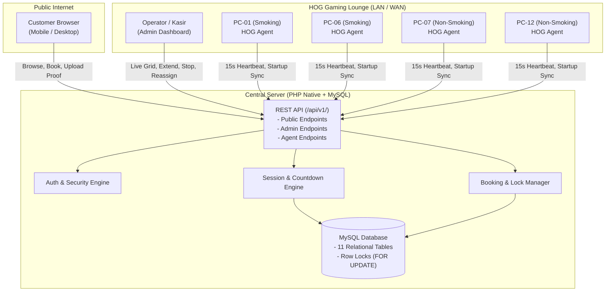
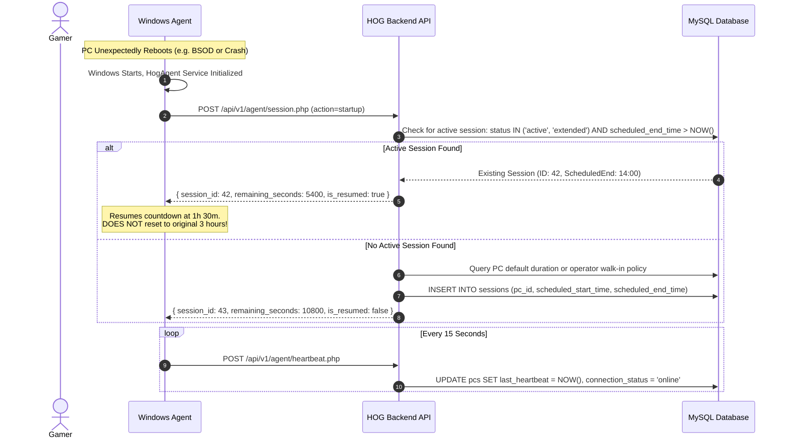

# Home Of Gamers (HOG) - System Architecture & Design Specification

## 1. Executive Summary

The **Home Of Gamers (HOG) PC Management & Booking System** is an enterprise-grade operational platform built for an internet gaming cafe operating 12 high-performance gaming PCs in Indonesia. The system coordinates the public booking website, an administrative control dashboard, a authoritative REST API, a relational MySQL database, and a lightweight Windows Agent installed on each gaming rig (`PC-01` through `PC-12`).

---

## 2. Strict Cyberindo Billing Isolation Model

Home Of Gamers currently relies on **Cyberindo Billing** for legacy billing and desktop locking. The HOG system operates with **ZERO interference** with Cyberindo Billing:

```
+-------------------------------------------------------------------------------+
|                             CLIENT GAMING PC                                  |
|                                                                               |
|  +---------------------------+             +-------------------------------+  |
|  |     Cyberindo Client      |             |       HOG Windows Agent       |  |
|  |  (Legacy Billing Client)  |             |  (.NET 8 Background Service)  |  |
|  +---------------------------+             +-------------------------------+  |
|                |                                           |                  |
|        [INDEPENDENT]                                [SECURE HTTPS]            |
|                |                                           |                  |
+----------------v-------------------------------------------v------------------+
        Cyberindo Server                            HOG Central Cloud /
      (Untouched / Isolated)                      Shared Hosting Backend
```

### Isolation Guarantees:
1. **No Process Injection or Hooking**: The HOG Agent does not attach debuggers, inject DLLs, or modify memory spaces of any Cyberindo executable.
2. **No Database Access**: HOG does not read, write, or alter Cyberindo's local or server databases.
3. **No UI Automation**: HOG does not synthesize keyboard or mouse events, nor does it close or suppress Cyberindo billing prompts.
4. **Independent Countdown Logic**: The HOG session countdown is driven authoritatively by the HOG backend API using server timestamps, independently of any local timers.
5. **Safe Fail-Soft**: If Cyberindo restarts or is upgraded, the HOG Agent continues normal operation without disruption.

---

## 3. High-Level System Architecture



---

## 4. Component Topology

### 4.1. Public Website (`backend/public/`)
- **Technology**: Native PHP, HTML5, Vanilla JavaScript, Tailwind CSS (via CDN) with bespoke dark-mode gaming aesthetics.
- **Key Capabilities**:
  - Live 12-rig availability telemetry polling every 10 seconds.
  - Interactive rig picker with room filters (Smoking: `PC-01`–`PC-06`, Non-Smoking: `PC-07`–`PC-12`).
  - Package selection (`Paket Pagi`, `Paket Siang`, `Paket Malam`, `Custom 2 Jam`).
  - Booking status page (`booking-status.php`) with real-time polling, replacement PC notices, and payment proof upload.

### 4.2. Admin Dashboard (`backend/admin/`)
- **Technology**: Native PHP session-authenticated dashboard with CSRF protection and audit logging.
- **Key Capabilities**:
  - **Live PC Grid**: Dynamic cards for all 12 PCs displaying connection status (`online`, `offline`), session state (`available`, `active`, `reserved`), remaining countdown, and quick actions (+30m, +60m, Stop).
  - **Walk-In Dispatcher**: Instant modal to allocate PCs for walk-in players with conflict checking against upcoming bookings.
  - **Payment Verification Queue**: View uploaded receipts, approve or reject transactions.
  - **Check-In & Same-Room Reassignment**: If a customer arrives late and their original PC is occupied, operators can reassign them to an eligible replacement PC *strictly within the same room type*.
  - **System Settings**: Configurable default session durations, heartbeat timeouts, and grace periods.

### 4.3. Authoritative Backend REST API (`backend/api/v1/`)
- **Routing & Endpoints**:
  - `/api/v1/agent/*`: Dedicated endpoints for Windows Agents (`auth.php`, `heartbeat.php`, `session.php`, `reconcile.php`).
  - `/api/v1/public/*`: Customer-facing endpoints (`pcs.php`, `packages.php`, `check-eligibility.php`, `book.php`, `upload-proof.php`, `status.php`).
  - `/api/v1/admin/*`: Operator endpoints (`auth.php`, `pcs.php`, `sessions.php`, `bookings.php`, `packages.php`, `settings.php`, `audit-logs.php`).

### 4.4. Windows Agent (`windows-agent/HogAgent/`)
- **Technology**: C# and .NET 8 Worker Service (`BackgroundService`), deployable via `sc.exe` as a native Windows Service with auto-start.
- **Key Capabilities**:
  - Automatic startup with Windows before or after user login.
  - Periodic heartbeat telemetry (default 15s) carrying client timestamp, agent version, and local system load.
  - Authoritative countdown synchronisation using server Unix timestamps.
  - Instant recovery after unexpected restarts without resetting the countdown timer.

---

## 5. Authoritative Session & Countdown Engine

### 5.1. Formula
Local computer clocks are inherently unreliable and susceptible to drift or manipulation. The backend API is the single source of truth:

$$\text{remaining\_seconds} = \max\left(0, \text{session\_end\_timestamp} - \text{server\_current\_timestamp}\right)$$

### 5.2. Restart Recovery Workflow



---

## 6. Concurrency & Booking Conflict Prevention

To prevent race conditions where two customers attempt to book the same PC for overlapping time windows, the system utilizes database-level transactions with **Row-Level Pessimistic Locking**:

```sql
START TRANSACTION;

-- 1. Lock the candidate PC record
SELECT id, pc_code, room_type, is_enabled 
FROM pcs 
WHERE id = :pc_id 
FOR UPDATE;

-- 2. Verify no overlapping active session exists
SELECT id FROM sessions 
WHERE pc_id = :pc_id 
  AND status IN ('active', 'extended')
  AND scheduled_end_time > :booking_start
FOR UPDATE;

-- 3. Verify no overlapping confirmed reservation exists
SELECT id FROM bookings 
WHERE (pc_id = :pc_id OR replacement_pc_id = :pc_id)
  AND booking_date = :booking_date
  AND status IN ('confirmed', 'active')
  AND (start_time < :end_time AND end_time > :start_time)
FOR UPDATE;

-- 4. If all checks pass, insert booking and commit
INSERT INTO bookings (...) VALUES (...);

COMMIT;
```

---

## 7. Late Arrival & Same-Room Reassignment Policy

### 7.1. Grace Period Expiration
1. Each booking has a configurable grace period (default 45 minutes, configurable between 15–120 minutes).
2. If `current_server_time > scheduled_start_time + grace_period_minutes` and `checked_in_at IS NULL`:
   - The booking transitions to `expired`.
   - The PC is unlocked and made available for walk-in players.
   - The booking history remains permanently in the database for financial reconciliation.

### 7.2. Same-Room PC Replacement Constraint
If a paid customer arrives late within valid store parameters and their original PC has been occupied:
- The system searches for an eligible vacant PC **strictly within the same room type**:
  - `Smoking Room`: `PC-01` through `PC-06`
  - `Non-Smoking Room`: `PC-07` through `PC-12`
- The system **strictly forbids** moving a customer from a Smoking Room to a Non-Smoking Room (or vice-versa) without manual manager authorization.
- If no replacement PC is available in the same room, the case is escalated on the admin dashboard with a warning badge.

---

## 8. Database Entity Relationship Model

```
+-------------------+       +-------------------+       +--------------------+
|       pcs         | 1   1 |     pc_agents     |       |      admins        |
+-------------------+-------+-------------------+       +--------------------+
| id (PK)           |       | id (PK)           |       | id (PK)            |
| pc_code (UNIQUE)  |       | pc_id (FK)        |       | username (UNIQUE)  |
| room_type         |       | agent_token_hash  |       | password_hash      |
| is_enabled        |       | version           |       | full_name          |
| connection_status |       | last_ip           |       | role               |
| current_session_id|       +-------------------+       +--------------------+
+---------+---------+
          | 1
          |
          | N
+---------v---------+       +-------------------+       +--------------------+
|     sessions      | N   1 |     packages      |       |  system_settings   |
+-------------------+-------+-------------------+       +--------------------+
| id (PK)           |       | id (PK)           |       | id (PK)            |
| pc_id (FK)        |       | name              |       | setting_key (UNIQ) |
| package_id (FK)   |       | room_type         |       | setting_value      |
| booking_id (FK)   |       | duration_minutes  |       | description        |
| scheduled_start   |       | price             |       +--------------------+
| scheduled_end     |       | is_active         |
| status            |       +---------+---------+
+-------------------+                 | 1
                                      |
                                      | N
+-------------------+ 1     N +-------v---------+ 1   1 +--------------------+
|     customers     +---------+     bookings    +-------+      payments      |
+-------------------+         +-------------------+       +--------------------+
| id (PK)           |         | id (PK)           |       | id (PK)            |
| phone (UNIQUE)    |         | booking_code (UNI)|       | booking_id (FK)    |
| name              |         | pc_id (FK)        |       | payment_method     |
| email             |         | customer_id (FK)  |       | payment_status     |
+-------------------+         | package_id (FK)   |       | amount             |
                              | replacement_pc_id |       | proof_image_path   |
                              | booking_date      |       | verified_by (FK)   |
                              | start_time        |       +--------------------+
                              | end_time          |
                              | status            |
                              +-------------------+
```

---

## 9. Security Model

1. **Agent Authentication**:
   - Every request from a Windows Agent carries `X-PC-Code` and `X-Agent-Key` HTTP headers.
   - The backend hashes the provided key using `SHA-256` and verifies it against the `pc_agents.agent_token_hash` record in the database using constant-time comparison (`hash_equals`).
2. **Administrator Security**:
   - Passwords hashed using `PASSWORD_BCRYPT` with cost factor 12.
   - Session fixation protection with periodic session regeneration.
   - CSRF token validation on all state-altering POST/PUT requests.
3. **Data Sanitization & Prepared Statements**:
   - 100% of SQL queries use PDO parameter binding.
   - User inputs sanitized against XSS using HTML entity encoding.
4. **File Upload Hardening**:
   - Payment proofs restricted to MIME types `image/jpeg`, `image/png`, and `image/webp`.
   - File size strictly capped at 5 MB.
   - Stored in a dedicated upload directory with randomized UUID filenames and sanitized extensions to prevent arbitrary script execution.
